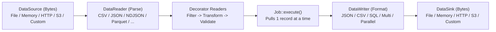

# Data-Genie Source Code Guide

Welcome! This guide explains how **`data-genie`** works under the hood so you can navigate the repository, understand the design patterns, and start contributing with confidence.

---

## 1. The 30-Second Mental Model

`data-genie` is a **pull-based, streaming ETL (Extract -> Transform -> Load) engine**.

Instead of loading an entire file into a giant `Vec`, it pulls **one record at a time** through a chain of async streams (`O(1)` memory):



Everything in the codebase revolves around **four core abstractions** (all defined in `src/core/traits.rs`):

| Concept | Rust Type / Trait | Responsibility |
| :--- | :--- | :--- |
| **Record** | `DataRecord` (`IndexMap<String, serde_json::Value>`) | One row/object. Uses `IndexMap` instead of `HashMap` so column order stays deterministic. |
| **Raw I/O** | `DataSource` / `DataSink` | Reads or writes raw **bytes** from disk, memory, HTTP, S3, or any custom backend. |
| **Record Pipeline** | `DataReader` / `DataWriter` | Parses bytes into a `RecordStream` (or serializes `DataRecord`s back out). Filters and transformers are also `DataReader`s that wrap another `DataReader`. |
| **Orchestrator** | `Job` | Drives the loop: pulls the next record from the reader, passes it to the writer, tracks metrics, and closes the writer at the end. |

---

## 2. Repository Map

```text
src/
├── lib.rs                 # Public API re-exports (what `use data_genie::*` exposes)
├── main.rs                # CLI binary (`data-genie run | preview | infer-schema`)
├── core/                  # Engine foundation
│   ├── traits.rs          # Core traits & aliases: DataRecord, RecordStream, DataSource, DataSink, DataReader, DataWriter
│   ├── error.rs           # Unified DataGenieError enum and Result<T> alias
│   ├── job.rs             # Job runner, block_on() sync bridge, lifecycle hooks, preview(), infer_schema()
│   ├── transport_utils.rs # SourceInput & SinkInput (lets readers/writers accept paths, bytes, or any DataSource/DataSink)
│   ├── file_transport.rs  # FileSource & FileSink (local disk)
│   ├── memory_transport.rs# MemorySource & MemorySink (in-memory zero-copy reads & shared buffer writes)
│   ├── http_transport.rs  # HttpSource & HttpSink (feature: `http`)
│   ├── s3_transport.rs    # S3Source & S3Sink built on `object_store` (feature: `s3`)
│   ├── expr.rs            # Lightweight expression parser & evaluator (e.g. `age >= 18 && city == 'Dublin'`)
│   └── pipeline_parser.rs # Parses YAML configs into a runtime pipeline using BoxedReader
├── readers/               # Format & connector readers (implement DataReader)
│   ├── csv_reader.rs      # Streaming CSV parser with fast path for unquoted lines + DLQ support
│   ├── tsv_reader.rs      # Thin wrapper around CSVReader with `\t` delimiter
│   ├── fixed_width_reader.rs
│   ├── nd_json_reader.rs  # Line-by-line streaming NDJSON
│   ├── json_reader.rs     # JSON array reader
│   ├── xml_reader.rs      # Pull-based XML reader (`quick-xml`) with XPath-style record paths
│   ├── parquet_reader.rs  # Apache Parquet reader (feature: `parquet`)
│   ├── xlsx_reader.rs     # Excel workbook reader (feature: `xlsx`)
│   ├── sql_reader.rs      # Paginated SQL reader via driver-agnostic `SqlConnection` trait
│   ├── http_reader.rs     # Paginated REST JSON API reader (feature: `http`)
│   └── memory_reader.rs   # Streams from an in-memory `Vec<DataRecord>`
├── filters/               # Record filtering (decorator DataReader + predicates)
│   ├── filtering_reader.rs    # FilteringReader<R>: wraps any DataReader and drops non-matching records
│   ├── field_filters.rs       # Reusable field rules (equals, regex, range, null checks, etc.)
│   └── filter_expressions.rs  # FilterExpression: parses string expressions via `core/expr.rs`
├── transformers/          # Record transformation, validation & aggregation (decorator DataReaders)
│   ├── transforming_reader.rs     # TransformingReader<R>: applies functions to each record
│   ├── field_transformers.rs      # Rename, select, remove, type-convert, calculated fields, PII masking
│   ├── validating_reader.rs       # ValidatingReader<R>: custom validation rules + DLQ routing
│   ├── schema_validating_reader.rs# SchemaValidatingReader<R>: typed RecordSchema validation + coercion
│   ├── remove_duplicates_reader.rs# Deduplication via pluggable DuplicateKeyStore
│   └── group_by_reader.rs         # In-memory grouping & aggregations (count, sum, avg, min, max)
└── writers/               # Output writers (implement DataWriter)
    ├── csv_writer.rs, tsv_writer.rs, fixed_width_writer.rs
    ├── json_writer.rs, nd_json_writer.rs, xml_writer.rs
    ├── parquet_writer.rs  # Feature: `parquet`
    ├── xlsx_writer.rs     # Feature: `xlsx`
    ├── sql_writer.rs      # Dialect-aware SQL inserts & upserts (Postgres, MySQL, SQLite, Oracle)
    ├── memory_writer.rs, console_writer.rs
    ├── callback_writer.rs, batch_callback_writer.rs
    ├── multi_writer.rs    # Fan-out: writes every record to multiple writers
    ├── parallel_writer.rs # Worker pool for concurrent writes
    └── retrying_writer.rs # Exponential backoff + circuit breaker wrapper

examples/                  # Small standalone runnable demos (start with `examples/csv_to_json.rs`)
tests/                     # `integration_tests.rs` (end-to-end tests) and `stress-test.rs`
```

---

## 3. Tracing One Pipeline End-to-End

Consider this simple program (like `examples/filter_transform.rs`):

```rust
let reader = CSVReader::new("users.csv");
let filtered = FilteringReader::new(reader)
    .add_rule(FilterExpression::new("age >= 18").create_record_filter());
let writer = JsonWriter::new("adults.json");

Job::run_blocking(filtered, writer)?;
```

Here is **exactly what happens step by step** inside the source code:

### Step 1: Wrapping the input (`SourceInput` / `SinkInput`)
`CSVReader::new` accepts `<S: Into<SourceInput>>`.
In `src/core/transport_utils.rs`, `SourceInput` has `From` implementations for:
- File paths (`&str`, `String`, `&Path`, `PathBuf`) -> automatically wrapped in `FileSource`
- Raw bytes (`Vec<u8>`, `&[u8]`, `&[u8; N]`) -> automatically wrapped in `MemorySource`
- **Any type implementing `DataSource`** (built-in or custom) via a blanket `impl<S: DataSource + 'static> From<S> for SourceInput`

So `"users.csv"` becomes `Arc<dyn DataSource>` backed by `FileSource`. No file is opened yet!
Similarly, `JsonWriter::new("adults.json")` converts `"adults.json"` into `Box<dyn DataSink>` backed by `FileSink`.

### Step 2: Composing decorators (still lazy!)
`FilteringReader::new(reader)` stores `CSVReader` inside its struct:
```text
FilteringReader {
    reader: CSVReader { source: Arc<FileSource>, ... },
    rules: [FilterExpression("age >= 18")],
}
```
Notice that **no I/O has happened yet**. You have only assembled a lightweight pipeline description in memory.

### Step 3: Bridging sync -> async (`block_on`)
`Job::run_blocking(filtered, writer)` in `src/core/job.rs` calls `block_on(Job::run(filtered, writer))`.
- If the caller is in a normal `fn main()`, `block_on` spins up a Tokio multi-threaded runtime and runs the future.
- If the caller is already inside a Tokio runtime, it uses `tokio::task::block_in_place` so it won't panic.

### Step 4: Pulling records (`Job::execute`)
Inside `Job::execute()` (`src/core/job.rs`):
1. Calls `let mut stream = self.reader.read();`.
   - `FilteringReader::read()` calls `self.reader.read()` on `CSVReader`.
   - Both use the `async_stream::try_stream!` macro to return a `RecordStream` (`Pin<Box<dyn Stream<Item = Result<Option<DataRecord>>> + Send>>`).
2. Runs a simple async loop:
   ```rust
   while let Some(item) = stream.next().await {
       let Some(record) = item? else { continue; };
       self.writer.write(record).await?;
   }
   ```
3. On the **first** `.next().await`:
   - `CSVReader` calls `source.get_buf_reader().await?`, which opens `users.csv` with a single 256 KB `BufReader`.
   - It reads one line, parses it into a `DataRecord`, and `yield`s `Some(record)`.
   - `FilteringReader` receives that single record, evaluates `age >= 18`, and either `yield`s it downstream or loops to pull the next line.
   - `Job` receives the passing record and calls `JsonWriter::write(record).await?`, which opens `adults.json` on the first write and buffers formatted JSON bytes.
4. When the stream finishes (EOF), `Job` calls `self.writer.close().await`:
   - `JsonWriter::close()` writes the closing `\n]`, flushes & shuts down the `ByteWriter`, and calls `sink.finalize().await?` (which triggers uploads for `S3Sink` / `HttpSink`).
   - `Job` returns `JobMetrics` (record count, duration, throughput).

---

## 4. Deep Dive into Key Subsystems

### A. Transports: `DataSource` & `DataSink` (`src/core/*_transport.rs`)

Separating **transport** (where bytes live) from **format** (how bytes are parsed) means `CSVReader`, `JsonReader`, `NDJsonReader`, `XMLReader`, `ParquetReader`, and `XlsxReader` all automatically work with local files, memory, HTTP, S3, and custom backends.

In `src/core/traits.rs`:
- `ByteReader` is `Pin<Box<dyn AsyncRead + Send + Unpin>>`
- `BufferedByteReader` is `Pin<Box<dyn AsyncBufRead + Send + Unpin>>`
- `ByteWriter` is `Pin<Box<dyn AsyncWrite + Send + Unpin>>`

To keep both ergonomics and performance high, `DataSource` has:
- **Required methods** (2 only):
  - `get_reader(&self) -> Result<ByteReader>`
  - `name(&self) -> Cow<'_, str>` (uses `Cow` so `MemorySource`/`HttpSource` borrow without allocating, while `FileSource`/`S3Source` format lazily without storing duplicate string fields)
- **Optional fast-path overrides** (with sensible defaults):
  - `get_buf_reader(&self)` — defaults to wrapping `get_reader()` in a 256 KB `BufReader`. `MemorySource` (backed by `Cursor<Arc<[u8]>>`), `HttpSource`, and `S3Source` (backed by `StreamReader`) override this because they are already buffered, avoiding double buffering and extra allocations.
  - `read_bytes(&self)` — used by formats that need random access or full payloads (`JsonReader`, `XMLReader`, `XlsxReader`, non-file `ParquetReader`). `FileSource` overrides it with `tokio::fs::read`, `HttpSource` with `response.bytes()`, and `S3Source` with `get_result.bytes()`.
  - `as_file_path(&self)` — returns `Some(&Path)` for `FileSource` so `ParquetReader` / `ParquetWriter` / `XlsxWriter` can operate directly on local files without buffering everything in memory.

### B. The Decorator Pattern for Filters, Transformers & Validators

Every middleware component in `src/filters/` and `src/transformers/` is generic over `<R: DataReader>` and **implements `DataReader` itself**:

```rust
pub struct FilteringReader<R: DataReader> {
    reader: R,
    rules: Vec<RecordFilterRule>,
}
```

Why this design?
- **Composable**: Wrap as many stages as you want in any order (`ValidatingReader<TransformingReader<FilteringReader<CSVReader>>>`).
- **Zero-cost static dispatch**: Rust monomorphizes the nested generic types at compile time instead of boxing every stage (except when building dynamic pipelines from YAML in `PipelineParser`, which uses `BoxedReader`).
- **Uniform interface**: `Job` does not need to know whether a reader is a raw `CSVReader` or a 5-stage transformed pipeline — it only talks to `DataReader`.

### C. Dead Letter Queue (DLQ) Propagation

Real-world data has bad rows. Instead of crashing mid-pipeline, you can attach a DLQ writer:

```rust
let validated = ValidatingReader::new(CSVReader::new("messy.csv"))
    .with_dlq(JsonWriter::new("errors.json"));
```

How does a CSV parse error inside `CSVReader` reach `errors.json`?
1. `ValidatingReader::with_dlq` wraps `JsonWriter` in a `SharedWriter` (`Arc<Mutex<Box<dyn DataWriter>>>`), which is cheap to clone and thread-safe.
2. It calls `self.reader.set_dlq(shared)` on its inner reader.
3. Every decorator (`FilteringReader`, `TransformingReader`, `SchemaValidatingReader`, etc.) forwards `set_dlq` and `set_ignore_errors` to its inner `self.reader`.
4. The `SharedWriter` propagates all the way up to `CSVReader` (or `JsonReader` / `NDJsonReader` / `XMLReader`), enabling `ignore_errors = true` and routing malformed rows to the exact same DLQ file.
5. Only the outer `ValidatingReader` closes the DLQ writer when the stream ends, so upstream and downstream stages never close it prematurely.

### D. Expressions (`src/core/expr.rs`)

Both `FilterExpression` (e.g., `"age >= 18 && country == 'IE'"`) and `SetCalculatedField` (e.g., `"price * quantity"`) use the self-contained recursive-descent parser and evaluator in `src/core/expr.rs`:
1. **Tokenizer** turns the string into tokens (identifiers, numbers, strings, operators).
2. **Parser** builds an AST (`Expr` enum) respecting operator precedence (`||`, `&&`, comparisons, `+`/`-`, `*`/`/`, unary `!`/`-`, parentheses).
3. **Evaluator** evaluates the compiled AST against each `&DataRecord` (no re-parsing per row!).

### E. Declarative YAML Pipelines (`src/core/pipeline_parser.rs`)

Because YAML pipeline steps aren't known at compile time, `PipelineParser` wraps each stage in `BoxedReader(pub Box<dyn DataReader>)` as it iterates over the `transform:` list in the YAML file. That lets it dynamically chain `CSVReader` -> `FilteringReader` -> `TransformingReader` -> etc., then hand the final `BoxedReader` to the same `Job::execute()` engine.

### F. Optional Cargo Feature Flags (`Cargo.toml`)

By default (`default = []`), `data-genie` compiles fast with minimal dependencies (CSV, TSV, FixedWidth, JSON, NDJSON, XML, SQL, Filters, Transformers). Heavy connectors are opt-in:

| Feature | Enables |
| :--- | :--- |
| `parquet` | `ParquetReader`, `ParquetWriter` (`parquet`, `arrow`, `bytes`) |
| `xlsx` | `XlsxReader`, `XlsxWriter` (`calamine`, `rust_xlsxwriter`) |
| `s3` | `S3Source`, `S3Sink` (`object_store`, `bytes`, `tokio-util`) |
| `http` | `HttpSource`, `HttpSink`, `HttpReader` (`reqwest`, `tokio-util`) |
| `full` | All of the above |

Look for `#[cfg(feature = "...")]` in `src/lib.rs`, `src/core/mod.rs`, `src/readers/mod.rs`, and `src/writers/mod.rs` to see where feature-gated modules are wired up.

---

## 5. How to Extend the Codebase

### Writing a Custom `DataSource`

You only need two methods (`get_reader` and `name`). Thanks to the blanket `From<S>` on `SourceInput`, your custom source works directly with every reader:

```rust
use async_trait::async_trait;
use data_genie::{ByteReader, CSVReader, DataSource, Result};
use std::borrow::Cow;

struct StaticCsvSource(&'static [u8]);

#[async_trait]
impl DataSource for StaticCsvSource {
    async fn get_reader(&self) -> Result<ByteReader> {
        Ok(Box::pin(std::io::Cursor::new(self.0)))
    }

    fn name(&self) -> Cow<'_, str> {
        Cow::Borrowed("static-csv")
    }
}

// Plugs straight into any reader — no wrapper needed:
let reader = CSVReader::new(StaticCsvSource(b"name,age\nAlice,30\n"));
```

### Writing a Custom Filter or Transformer

You don't even need a new struct — closures work directly:

```rust
let filtered = FilteringReader::new(reader)
    .add(|record| record.get("active").and_then(|v| v.as_bool()).unwrap_or(false));

let transformed = TransformingReader::new(filtered)
    .add(|mut record| {
        record.insert("source".to_string(), serde_json::json!("import"));
        record
    });
```

---

## 6. Scary Rust Types Decoded (Newbie Cheat Sheet)

If you are newer to async Rust, a few type signatures in this codebase look intimidating at first glance. Here is what each piece actually means and what you need to write in practice.

### Breaking down `Pin<Box<dyn AsyncRead + Send + Unpin>>` (`ByteReader`)

You don't need to write this type by hand—use the `ByteReader`, `BufferedByteReader`, and `ByteWriter` aliases in [`src/core/traits.rs`](src/core/traits.rs). Each wrapper solves one specific Rust requirement:

- **`dyn AsyncRead`** — "Any concrete type that can read bytes asynchronously" (`tokio::fs::File`, `Cursor<Arc<[u8]>>`, `StreamReader`, etc.).
- **`Box<...>`** — Puts the value on the heap because different reader types have different sizes in memory.
- **`Pin<...>`** — Promises Rust/Tokio that the reader will not move in memory while an async poll is in progress.
- **`+ Send`** — Safe to move between Tokio's worker threads.
- **`+ Unpin`** — Tells callers they can call `.read()` / `.read_line()` directly without manually pinning it.

**In practice:** when implementing a `DataSource`, you just write `Ok(Box::pin(my_reader))`.

### Common Patterns Across the Repo

| What you see in code | Plain-English meaning | What you usually write |
| :--- | :--- | :--- |
| `ByteReader` (`Pin<Box<dyn AsyncRead + Send + Unpin>>`) | Any async byte reader, safe across threads | `Ok(Box::pin(reader))` |
| `BufferedByteReader` (`Pin<Box<dyn AsyncBufRead + Send + Unpin>>`) | Same as `ByteReader`, already buffered for `.read_line()` / `.lines()` | `Ok(Box::pin(BufReader::new(reader)))` or `Ok(Box::pin(cursor))` |
| `ByteWriter` (`Pin<Box<dyn AsyncWrite + Send + Unpin>>`) | Any async byte writer, safe across threads | `Ok(Box::pin(writer))` |
| `RecordStream` (`Pin<Box<dyn Stream<Item = Result<Option<DataRecord>>> + Send>>`) | An async iterator yielding one record at a time | `Box::pin(try_stream! { yield Some(record); })` |
| `Arc<dyn DataSource>` | A shared, thread-safe pointer to any `DataSource` | `Arc::clone(&self.source)` |
| `SharedWriter` (`Arc<Mutex<Box<dyn DataWriter>>>`) | A writer multiple stages can safely share (used for DLQ) | `SharedWriter::new(writer)` |
| `Cow<'_, str>` | Either a borrowed `&str` (zero allocation) or an owned `String` | `Cow::Borrowed("...")` or `Cow::Owned(format!(...))` |
| `#[async_trait]` | Allows a trait with `async fn` to work behind `dyn Trait` | Place `#[async_trait]` above `impl DataSource for ...` |
| `S: Into<SourceInput>` | Accepts `"file.csv"`, `PathBuf`, `Vec<u8>`, or any `DataSource` | Pass any of them directly to `CSVReader::new(...)` |

---

## 7. Main Files & What to Read First

If you want to understand ~80% of the entire codebase as fast as possible, read these files **in this exact order** (Tier 1 + Tier 2 is just 8 small files):

### Tier 1: Must Read First (The Core Engine)
1. **[`examples/csv_to_json.rs`](examples/csv_to_json.rs)** *(13 lines)*
   - Start here to see how a user runs a pipeline before diving into internals.
2. **[`src/core/traits.rs`](src/core/traits.rs)** *(most important file in the repo)*
   - Defines every core contract: `DataRecord`, `RecordStream`, `DataSource`, `DataSink`, `DataReader`, `DataWriter`, and `SharedWriter` (DLQ). Everything else in `src/` implements these traits.
3. **[`src/core/job.rs`](src/core/job.rs)** *(focus on `block_on` and `Job::execute`, lines 16–256)*
   - Shows the runtime loop that pulls one record at a time from a `DataReader`, pushes it into a `DataWriter`, tracks metrics, and closes the writer.
4. **[`src/core/transport_utils.rs`](src/core/transport_utils.rs)** & **[`src/core/file_transport.rs`](src/core/file_transport.rs)**
   - Explains how readers and writers accept strings (`"data.csv"`), byte buffers, or any custom `DataSource`/`DataSink` seamlessly, and how raw bytes are opened and buffered.

### Tier 2: One Example of Each Pipeline Stage
Once Tier 1 clicks, read **one clean file from each folder**—every other reader, decorator, and writer follows the exact same pattern:

5. **[`src/readers/nd_json_reader.rs`](src/readers/nd_json_reader.rs)** *(cleanest streaming reader)*
   - Shows how `source.get_buf_reader()`, `async_stream::try_stream!`, schema validation, and DLQ error routing work together. Read [`src/readers/csv_reader.rs`](src/readers/csv_reader.rs) next if you want to see CSV-specific optimizations.
6. **[`src/filters/filtering_reader.rs`](src/filters/filtering_reader.rs)** & **[`src/transformers/transforming_reader.rs`](src/transformers/transforming_reader.rs)** *(~60–80 lines each)*
   - Shows the **decorator pattern**: filters and transformers wrap an inner `DataReader`, implement `DataReader` themselves, and forward `set_dlq` upstream.
7. **[`src/writers/nd_json_writer.rs`](src/writers/nd_json_writer.rs)** *(51 lines, cleanest streaming writer)*
   - Shows lazy stream opening (`sink.get_writer()`), writing records, flushing/shutting down, and calling `sink.finalize()`.

### Tier 3: Read Only When You Need Those Features
- **Error handling**: [`src/core/error.rs`](src/core/error.rs)
- **Validation & DLQ**: [`src/transformers/validating_reader.rs`](src/transformers/validating_reader.rs)
- **Filter/calculated expressions (`age >= 18`)**: [`src/core/expr.rs`](src/core/expr.rs)
- **YAML pipelines & CLI**: [`src/core/pipeline_parser.rs`](src/core/pipeline_parser.rs) and [`src/main.rs`](src/main.rs)
- **Public API surface**: [`src/lib.rs`](src/lib.rs)
- **End-to-end behavior**: [`tests/integration_tests.rs`](tests/integration_tests.rs)

---

## 8. Useful Dev Commands

```bash
# Run a small standalone example (no files or features needed)
cargo run --example csv_to_json

# Run tests (minimal default features)
cargo test

# Run the full test suite (including parquet, xlsx, s3, http)
cargo test --all-features

# Check formatting and lints
cargo fmt --check
cargo clippy --all-features --tests --examples
```
