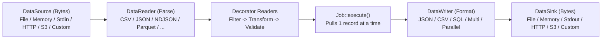

# Data-Genie Codebase & Developer Guide

Welcome! This guide explains how **`data-genie`** works under the hood so you can set up your environment, navigate the repository, understand the design
patterns and invariants, and start contributing with confidence.

---

## Table of Contents

1. [Prerequisites & First Run](#1-prerequisites--first-run)
2. [The 30-Second Mental Model](#2-the-30-second-mental-model)
3. [Repository Map](#3-repository-map)
4. [Tracing One Pipeline End-to-End](#4-tracing-one-pipeline-end-to-end)
5. [Deep Dive into Key Subsystems](#5-deep-dive-into-key-subsystems)
6. [Engineering Invariants (Must-Know Rules)](#6-engineering-invariants-must-know-rules)
7. [Scary Rust Types Decoded (Newbie Cheat Sheet)](#7-scary-rust-types-decoded-newbie-cheat-sheet)
8. [Main Files & What to Read First](#8-main-files--what-to-read-first)
9. [How to Extend & Contribute (Step-by-Step Recipes)](#9-how-to-extend--contribute-step-by-step-recipes)
10. [Common Development Commands](#10-common-development-commands)
11. [Dependency Hygiene, Publishing & PR Checklist](#11-dependency-hygiene-publishing--pr-checklist)

---

## 1. Prerequisites & First Run

- **Rust toolchain (Edition 2024)**: Install or update via [rustup.rs](https://rustup.rs/) (`rustup update stable`).
- **Components**: `rustfmt` and `clippy` (`rustup component add rustfmt clippy`).
- **Optional (for code coverage reports)**: `cargo install cargo-llvm-cov`.

Verify your environment right after cloning:

```shell
# 1. Run default (core-only) tests
cargo test

# 2. Run the full test suite with all optional features + CLI tests
cargo test --all-features

# 3. Run a standalone example
cargo run --example csv_to_json
```

---

## 2. The 30-Second Mental Model

`data-genie` is a **pull-based, streaming ETL (Extract -> Transform -> Load) engine**.

Instead of loading an entire file into a giant `Vec`, it pulls **one record at a time** through a chain of async streams (`O(1)` memory):



Everything in the codebase revolves around **four core abstractions** (all defined in `src/core/traits.rs`):

| Concept | Rust Type / Trait | Responsibility |
| :--- | :--- | :--- |
| **Record** | `DataRecord` (`IndexMap<String, serde_json::Value>`) | One row/object. Uses `IndexMap` instead of `HashMap` so column order stays deterministic. |
| **Raw I/O** | `DataSource` / `DataSink` | Reads or writes raw **bytes** from disk, memory, stdin/stdout, HTTP, S3, or any custom backend. |
| **Record Pipeline** | `DataReader` / `DataWriter` | Parses bytes into a `RecordStream` (or serializes `DataRecord`s back out). Filters and transformers are also `DataReader`s that wrap another `DataReader`. |
| **Orchestrator** | `Job` | Drives the loop: pulls the next record from the reader, passes it to the writer, tracks metrics, and calls `close()` on success or `abort()` on error. |

---

## 3. Repository Map

`data-genie` is a **single Cargo crate** (`lib` + optional `bin`) using Cargo `[features]` (`default = []`) to keep default builds fast and lightweight while
keeping maintenance and publishing simple.

```text
data-genie-rs/
├── Cargo.toml                  # Single crate manifest (features: xml, yaml, cli, parquet, xlsx, http, s3, full)
├── rustfmt.toml                # Formatting rules (edition 2024, max_width = 160)
├── .cargo/config.toml          # Cargo aliases (`cargo cov`, `cargo cov-html`, `cargo stress-test`)
├── src/
│   ├── lib.rs                  # Public API re-exports (what `use data_genie::*` exposes) + `#[doc(hidden)] pub use serde_json;`
│   ├── main.rs                 # CLI binary (`data-genie run | validate | preview | infer-schema`) [feature: yaml / cli]
│   ├── core/                   # Engine foundation
│   │   ├── traits.rs           # Core traits & aliases: DataRecord, RecordStream, DataSource, DataSink, DataReader, DataWriter, SharedWriter, `record!`
│   │   ├── error.rs            # Unified DataGenieError enum and Result<T> alias
│   │   ├── job.rs              # Job runner, block_on() / block_on_send() sync bridge, lifecycle hooks, preview(), infer_schema()
│   │   ├── transport_utils.rs  # SourceInput & SinkInput (lets readers/writers accept paths, bytes, or any DataSource/DataSink)
│   │   ├── file_transport.rs   # FileSource & FileSink (local disk)
│   │   ├── memory_transport.rs # MemorySource, MemorySink & SharedVecWriter (zero-copy reads & shared buffer writes)
│   │   ├── stdio_transport.rs  # StdinSource & StdoutSink (Unix pipe integration)
│   │   ├── http_transport.rs   # HttpSource & HttpSink [feature: `http`]
│   │   ├── s3_transport.rs     # S3Source & S3Sink built on `object_store` [feature: `s3`]
│   │   ├── expr.rs             # Lightweight expression parser & evaluator (e.g. `age >= 18 && city == 'Dublin'`)
│   │   └── pipeline_parser.rs  # Parses & validates YAML configs into a runtime pipeline using BoxedReader [feature: `yaml`]
│   ├── readers/                # Format & connector readers (implement DataReader)
│   │   ├── csv_reader.rs       # Streaming RFC 4180 CSV parser with fast path, BOM handling & DLQ support
│   │   ├── tsv_reader.rs       # Streaming TSV reader with tab delimiter & DLQ support
│   │   ├── fixed_width_reader.rs
│   │   ├── nd_json_reader.rs   # Line-by-line streaming NDJSON
│   │   ├── json_reader.rs      # Streaming JSON array reader
│   │   ├── xml_reader.rs       # Pull-based XML reader (`quick-xml`) with XPath-style record paths [feature: `xml`]
│   │   ├── parquet_reader.rs   # Apache Parquet reader [feature: `parquet`]
│   │   ├── xlsx_reader.rs      # Excel workbook reader (`calamine`) [feature: `xlsx`]
│   │   ├── sql_reader.rs       # Paginated SQL reader via driver-agnostic `SqlConnection` trait
│   │   ├── http_reader.rs      # Paginated REST JSON API reader (`reqwest`) [feature: `http`]
│   │   └── memory_reader.rs    # Streams from an in-memory `Arc<[DataRecord]>`
│   ├── filters/                # Record filtering (decorator DataReader + predicates)
│   │   ├── filtering_reader.rs     # FilteringReader<R>: wraps any DataReader and drops non-matching records
│   │   ├── field_filters.rs        # Reusable field rules (equals, regex, range, null checks, etc.)
│   │   └── filter_expressions.rs   # FilterExpression: parses string expressions via `core/expr.rs`
│   ├── transformers/           # Record transformation, validation & aggregation (decorator DataReaders)
│   │   ├── transforming_reader.rs      # TransformingReader<R>: applies functions to each record
│   │   ├── field_transformers.rs       # Rename, select, remove, type-convert, calculated fields, PII masking
│   │   ├── validating_reader.rs        # ValidatingReader<R>: custom validation rules + DLQ routing
│   │   ├── schema_validating_reader.rs # SchemaValidatingReader<R>: typed RecordSchema validation + coercion
│   │   ├── remove_duplicates_reader.rs # Deduplication via pluggable DuplicateKeyStore & `max_keys` guard
│   │   └── group_by_reader.rs          # Incremental O(G) grouping & aggregations (count, sum, avg, min, max)
│   └── writers/                # Output writers (implement DataWriter)
│       ├── csv_writer.rs, tsv_writer.rs, fixed_width_writer.rs
│       ├── json_writer.rs, nd_json_writer.rs
│       ├── xml_writer.rs       # Streaming XML writer [feature: `xml`]
│       ├── parquet_writer.rs   # Apache Arrow/Parquet writer [feature: `parquet`]
│       ├── xlsx_writer.rs      # Excel workbook writer (`rust_xlsxwriter`) [feature: `xlsx`]
│       ├── sql_writer.rs       # Dialect-aware SQL inserts & upserts (Postgres, MySQL, SQLite, Oracle)
│       ├── memory_writer.rs, console_writer.rs
│       ├── callback_writer.rs, batch_callback_writer.rs
│       ├── multi_writer.rs     # Fan-out: writes every record to multiple writers
│       ├── parallel_writer.rs  # Worker pool for concurrent writes (lazy worker spawning)
│       └── retrying_writer.rs  # Exponential backoff + Closed/Open/HalfOpen circuit breaker
├── examples/                   # Small standalone runnable demos (`examples/csv_to_json.rs`) + `coverage_report.rs`
├── tests/                      # `integration_tests.rs` (end-to-end + CLI tests) and `stress-test.rs`
└── docs/                       # VitePress documentation site
```

---

## 4. Tracing One Pipeline End-to-End

Consider this simple program (like `examples/filter_transform.rs`):

```rust
let reader = CSVReader::new("users.csv");
let filtered = FilteringReader::new(reader)
    .add_rule(FilterExpression::new("age >= 18").create_record_filter());
let writer = JsonWriter::new("adults.json");

Job::run_blocking(filtered, writer)?;
```

Here is **exactly what happens step by step** inside the source code:

### Step 1: Wrapping the input (`SourceInput` / `SinkInput`)
`CSVReader::new` accepts `<S: Into<SourceInput>>`.
In `src/core/transport_utils.rs`, `SourceInput` has `From` implementations for:
- File paths (`&str`, `String`, `&Path`, `PathBuf`) -> automatically wrapped in `FileSource`
- Raw bytes (`Vec<u8>`, `&[u8]`, `&[u8; N]`) -> automatically wrapped in `MemorySource`
- **Any type implementing `DataSource`** (built-in or custom) via a blanket `impl<S: DataSource + 'static> From<S> for SourceInput`

So `"users.csv"` becomes `Arc<dyn DataSource>` backed by `FileSource`. No file is opened yet!
Similarly, `JsonWriter::new("adults.json")` converts `"adults.json"` into `Box<dyn DataSink>` backed by `FileSink`.

### Step 2: Composing decorators (still lazy!)
`FilteringReader::new(reader)` stores `CSVReader` inside its struct:
```text
FilteringReader {
    reader: CSVReader { source: Arc<FileSource>, ... },
    rules: [FilterExpression("age >= 18")],
}
```
Notice that **no I/O has happened yet**. You have only assembled a lightweight pipeline description in memory.

### Step 3: Bridging sync -> async (`block_on` / `block_on_send`)
`Job::run_blocking(filtered, writer)` in `src/core/job.rs` calls `block_on_send(self.execute())`:
- If the caller is in a normal `fn main()`, it spins up a Tokio multi-threaded runtime and runs the future.
- If the caller is already inside a multi-threaded Tokio runtime, it uses `tokio::task::block_in_place`.
- If the caller is inside a `current_thread` Tokio runtime (where `block_in_place` would panic), `block_on_send` runs the future on a scoped OS thread via `std::thread::scope`.

### Step 4: Pulling records (`Job::execute`)
Inside `Job::execute()` (`src/core/job.rs`):
1. Calls `let mut stream = self.reader.read();`.
   - `FilteringReader::read()` calls `self.reader.read()` on `CSVReader`.
   - Both use the `async_stream::try_stream!` macro to return a `RecordStream` (`Pin<Box<dyn Stream<Item = Result<Option<DataRecord>>> + Send>>`).
2. Runs a simple async loop:
   ```rust
   while let Some(item) = stream.next().await {
       let Some(record) = item? else { continue; };
       self.writer.write(record).await?;
   }
   ```
3. On the **first** `.next().await`:
   - `CSVReader` calls `source.get_buf_reader().await?`, which opens `users.csv` with a single 256 KB `BufReader`.
   - It reads one line (stripping any UTF-8 BOM), parses it into a `DataRecord`, and `yield`s `Some(record)`.
   - `FilteringReader` receives that single record, evaluates `age >= 18`, and either `yield`s it downstream or loops to pull the next line.
   - `Job` receives the passing record and calls `JsonWriter::write(record).await?`, which opens `adults.json` on the first write and streams formatted JSON bytes.
4. On completion:
   - **Success (EOF):** `Job` calls `self.writer.close().await` — `JsonWriter::close()` writes the closing `\n]`, flushes & shuts down the `ByteWriter`, and calls `sink.finalize().await?` (which triggers uploads for `S3Sink` / `HttpSink`), then returns `JobMetrics`.
   - **Failure (any read/write error):** `Job` calls `self.writer.abort().await` instead of `close()` so partial/corrupted files or S3/HTTP uploads are discarded rather than committed.

---

## 5. Deep Dive into Key Subsystems

### A. Transports: `DataSource` & `DataSink` (`src/core/*_transport.rs`)

Separating **transport** (where bytes live) from **format** (how bytes are parsed) means `CSVReader`, `JsonReader`, `NDJsonReader`, `XMLReader`, `ParquetReader`, and `XlsxReader` all automatically work with local files, memory, stdin/stdout, HTTP, S3, and custom backends.

In `src/core/traits.rs`:
- `ByteReader` is `Pin<Box<dyn AsyncRead + Send + Unpin>>`
- `BufferedByteReader` is `Pin<Box<dyn AsyncBufRead + Send + Unpin>>`
- `ByteWriter` is `Pin<Box<dyn AsyncWrite + Send + Unpin>>`

To keep both ergonomics and performance high, `DataSource` has:
- **Required methods** (2 only):
  - `get_reader(&self) -> Result<ByteReader>`
  - `name(&self) -> Cow<'_, str>` (uses `Cow` so `MemorySource`/`HttpSource`/`StdinSource` borrow without allocating, while `FileSource`/`S3Source` format lazily without storing duplicate string fields)
- **Optional fast-path overrides** (with sensible defaults):
  - `get_buf_reader(&self)` — defaults to wrapping `get_reader()` in a 256 KB `BufReader`. `MemorySource` (backed by `Cursor<Arc<[u8]>>`), `HttpSource`, and `S3Source` (backed by `StreamReader`) override this because they are already buffered, avoiding double buffering and extra allocations.
  - `read_bytes(&self)` — used by formats that need random access or full payloads (`JsonReader`, `XMLReader`, `XlsxReader`, non-file `ParquetReader`). `FileSource` overrides it with `tokio::fs::read`, `HttpSource` with `response.bytes()`, and `S3Source` with `get_result.bytes()`.
  - `as_file_path(&self)` — returns `Some(&Path)` for `FileSource` so `ParquetReader` / `ParquetWriter` / `XlsxWriter` can operate directly on local files without buffering everything in memory.

### B. The Decorator Pattern for Filters, Transformers & Validators

Every middleware component in `src/filters/` and `src/transformers/` is generic over `<R: DataReader>` and **implements `DataReader` itself**:

```rust
pub struct FilteringReader<R: DataReader> {
    reader: R,
    rules: Vec<RecordFilterRule>,
}
```

Why this design?
- **Composable**: Wrap as many stages as you want in any order (`ValidatingReader<TransformingReader<FilteringReader<CSVReader>>>`).
- **Zero-cost static dispatch**: Rust monomorphizes the nested generic types at compile time instead of boxing every stage (except when building dynamic pipelines from YAML in `PipelineParser`, which uses `BoxedReader`).
- **Uniform interface**: `Job` does not need to know whether a reader is a raw `CSVReader` or a 5-stage transformed pipeline — it only talks to `DataReader`.

### C. Dead Letter Queue (DLQ) Propagation

Real-world data has bad rows. Instead of crashing mid-pipeline, you can attach a DLQ writer:

```rust
let validated = ValidatingReader::new(CSVReader::new("messy.csv"))
    .with_dlq(JsonWriter::new("errors.json"));
```

How does a CSV parse error inside `CSVReader` reach `errors.json`?
1. `ValidatingReader::with_dlq` wraps `JsonWriter` in a `SharedWriter` (`Arc<Mutex<Box<dyn DataWriter>>>`), which is cheap to clone and thread-safe.
2. It calls `self.reader.propagate_dlq(shared)` on its inner reader (distinguishing an *owned* DLQ from a *propagated* one).
3. Every decorator (`FilteringReader`, `TransformingReader`, `SchemaValidatingReader`, etc.) forwards `propagate_dlq` and `set_ignore_errors` upstream to its inner `self.reader`, while preserving any distinct DLQ already attached to an inner stage.
4. The `SharedWriter` propagates all the way up to `CSVReader` (or `TSVReader` / `JsonReader` / `NDJsonReader` / `XMLReader`), enabling `ignore_errors = true` and routing malformed rows to the exact same DLQ file.
5. Only the reader that **owns** a DLQ closes it when the stream ends via `SharedWriter::close_dlq()` (which is idempotent), and `dlq_record_count()` sums `local_dlq_records + inner.dlq_record_count()` so multi-stage metrics stay accurate.

### D. Expressions (`src/core/expr.rs`)

Both `FilterExpression` (e.g., `"age >= 18 && country == 'IE'"`) and `SetCalculatedField` (e.g., `"price * quantity"`) use the self-contained recursive-descent parser and evaluator in `src/core/expr.rs`:
1. **Tokenizer** turns the string into tokens (identifiers, numbers including scientific notation, escaped strings, operators).
2. **Parser** builds an AST (`Expr` enum) respecting operator precedence (`?:`, `||`, `&&`, comparisons, `+`/`-`, `*`/`/`, unary `!`/`-`, parentheses) with a recursion depth guard.
3. **Evaluator** evaluates the compiled AST against each `&DataRecord` (no re-parsing per row!), with division-by-zero checks and safe numeric coercion.

### E. Declarative YAML Pipelines (`src/core/pipeline_parser.rs`)

Gated behind `#[cfg(feature = "yaml")]`, `PipelineParser` wraps each stage in `BoxedReader(pub Box<dyn DataReader>)` as it iterates over the `transform:` list in the YAML file. That lets it dynamically chain `CSVReader` -> `FilteringReader` -> `TransformingReader` -> etc., then hand the final `BoxedReader` to the same `Job::execute()` engine. `PipelineConfig::validate()` collects all config errors together before executing anything.

### F. Optional Cargo Feature Flags & Design Rationale (`Cargo.toml`)

By default (`default = []`), `data-genie` compiles fast with minimal dependencies (**54 transitive crates**). Optional formats, YAML pipelines, CLI, and cloud connectors are opt-in:

| Feature | Enables | Extra Dependencies Pulled |
| :--- | :--- | :--- |
| *(default / core)* | CSV, TSV, FixedWidth, JSON, NDJSON, SQL, Memory, File/Stdio, Filters, Transformers, Validation/DLQ, Schema Inference | `tokio`, `futures-core`, `futures-util`, `async-stream`, `async-trait`, `serde`, `serde_json`, `indexmap`, `csv`, `regex`, `sha2`, `chrono` |
| `xml` | `XMLReader`, `XMLWriter` | `quick-xml` |
| `yaml` | `PipelineParser`, `PipelineConfig`, `BoxedReader` (also enables `xml`) | `serde_yaml_ng`, `quick-xml` |
| `cli` | `data-genie` CLI binary (alias for `["yaml", "xml"]`) | `serde_yaml_ng`, `quick-xml` |
| `parquet` | `ParquetReader`, `ParquetWriter`, `ParquetSchema` | `parquet`, `arrow`, `bytes` |
| `xlsx` | `XlsxReader`, `XlsxWriter` | `calamine`, `rust_xlsxwriter` |
| `s3` | `S3Source`, `S3Sink` | `object_store`, `bytes`, `tokio-util` |
| `http` | `HttpSource`, `HttpSink`, `HttpReader` | `reqwest` (rustls), `tokio-util` |
| `full` | All of the above (`xml`, `yaml`, `parquet`, `xlsx`, `s3`, `http`) | All optional connectors |

**Why do JSON and CSV stay in core instead of separate features?**
1. **JSON adds zero extra dependencies:** Every record is `DataRecord = IndexMap<String, serde_json::Value>`, and `serde_json` is already required across the engine (`record!`, `Expr`, `JobMetrics`, `ConsoleWriter`, `RemoveDuplicatesReader`, `SQLWriter`). Gating JSON behind a feature would save 0 dependencies and add friction.
2. **CSV is tiny; optional features gate heavy or niche stacks:** `csv` adds only two small pure-Rust crates (`csv` + `csv-core`; `itoa`, `ryu`, and `serde_core` are already in core via `serde_json`), and `tsv`, `fixed_width`, and `sql` add zero extra dependencies. By contrast, `parquet` (~100+ crates), `http` (reqwest/rustls/hyper), `s3` (object_store/AWS), `xlsx` (calamine/rust_xlsxwriter), `yaml` (`unsafe-libyaml`), and `xml` (`quick-xml`) are strictly opt-in.
3. **Rule of thumb for new contributions:** Put lightweight, zero-dependency or core-engine features directly in core. Gate any new format, cloud storage provider, message broker, or database driver that introduces non-trivial third-party dependencies behind an optional Cargo feature in [Cargo.toml](Cargo.toml).

Look for `#[cfg(feature = "...")]` in `src/lib.rs`, `src/core/mod.rs`, `src/core/error.rs`, `src/readers/mod.rs`, and `src/writers/mod.rs` to see where feature-gated modules are wired up.

---

## 6. Engineering Invariants (Must-Know Rules)

Before writing code, internalize these five invariants — they are tested explicitly in `tests/integration_tests.rs`:

1. **`O(1)` Streaming Memory by Default**
   - Build readers with `async_stream::try_stream!` and yield records incrementally.
   - Never collect all records into a `Vec<DataRecord>` unless the operation inherently requires materialization (e.g., `GroupByReader`, `XlsxWriter` workbook generation).

2. **Safe Writer Lifecycle (`write` / `close` / `abort`)**
   - Every `DataWriter` must track `is_closed: bool`.
   - `close()` must be **idempotent** (calling `close()` twice must be a no-op — never overwrite an already finalized S3/HTTP/file output with 0 bytes!).
   - Calling `write()` after `close()` or `abort()` must return an `Err(...)`.
   - On any job error, `Job::execute()` calls `writer.abort().await` instead of `close()`. Writers must discard buffered data and call `self.sink.abort().await` so partial/corrupted files or uploads are not committed.

3. **DLQ Ownership & Upstream Propagation**
   - Wrapper readers (`FilteringReader`, `TransformingReader`, `ValidatingReader`, `SchemaValidatingReader`, etc.) must implement `propagate_dlq(&mut self, writer: SharedWriter)` and `set_ignore_errors(&mut self, ignore: bool)` to forward configuration upstream.
   - Only the reader that **owns** the DLQ closes it when the stream finishes via `SharedWriter::close_dlq()`.
   - `dlq_record_count()` must return `local_dlq_records + inner.dlq_record_count()` so multi-stage DLQ counts sum accurately without double-counting.

4. **Feature-Gated Error Conversions**
   - `DataGenieError` in `src/core/error.rs` uses `String` variants (`Xml(String)`, `Yaml(String)`, `Parquet(String)`, `Xlsx(String)`, `Http(String)`, `ObjectStore(String)`) so the enum shape never changes across feature combinations, with `#[cfg(feature = "...")] impl From<...>` conversions gated cleanly.

5. **Sync/Async Safety & Macro Hygiene**
   - Blocking wrappers (`Job::run_blocking`, `PipelineParser::run_blocking`) use `block_on_send` so they never panic if called inside an existing `current_thread` Tokio runtime.
   - Constructors (e.g., `ParallelWriter::new`) must not call `tokio::spawn` synchronously — spawn background tasks lazily on first `write()` so they work cleanly with `Job::run_blocking`.
   - `record!` uses `$crate::serde_json::json!` (with `#[doc(hidden)] pub use serde_json;` in `src/lib.rs`) so downstream callers don't need `serde_json` in their own `Cargo.toml`.

---

## 7. Scary Rust Types Decoded (Newbie Cheat Sheet)

If you are newer to async Rust, a few type signatures in this codebase look intimidating at first glance. Here is what each piece actually means and what you need to write in practice.

### Breaking down `Pin<Box<dyn AsyncRead + Send + Unpin>>` (`ByteReader`)

You don't need to write this type by hand — use the `ByteReader`, `BufferedByteReader`, and `ByteWriter` aliases in [`src/core/traits.rs`](src/core/traits.rs). Each wrapper solves one specific Rust requirement:

- **`dyn AsyncRead`** — "Any concrete type that can read bytes asynchronously" (`tokio::fs::File`, `Cursor<Arc<[u8]>>`, `StreamReader`, etc.).
- **`Box<...>`** — Puts the value on the heap because different reader types have different sizes in memory.
- **`Pin<...>`** — Promises Rust/Tokio that the reader will not move in memory while an async poll is in progress.
- **`+ Send`** — Safe to move between Tokio's worker threads.
- **`+ Unpin`** — Tells callers they can call `.read()` / `.read_line()` directly without manually pinning it.

**In practice:** when implementing a `DataSource`, you just write `Ok(Box::pin(my_reader))`.

### Common Patterns Across the Repo

| What you see in code | Plain-English meaning | What you usually write |
| :--- | :--- | :--- |
| `ByteReader` (`Pin<Box<dyn AsyncRead + Send + Unpin>>`) | Any async byte reader, safe across threads | `Ok(Box::pin(reader))` |
| `BufferedByteReader` (`Pin<Box<dyn AsyncBufRead + Send + Unpin>>`) | Same as `ByteReader`, already buffered for `.read_line()` / `.lines()` | `Ok(Box::pin(BufReader::new(reader)))` or `Ok(Box::pin(cursor))` |
| `ByteWriter` (`Pin<Box<dyn AsyncWrite + Send + Unpin>>`) | Any async byte writer, safe across threads | `Ok(Box::pin(writer))` |
| `RecordStream` (`Pin<Box<dyn Stream<Item = Result<Option<DataRecord>>> + Send>>`) | An async iterator yielding one record at a time | `Box::pin(try_stream! { yield Some(record); })` |
| `Arc<dyn DataSource>` | A shared, thread-safe pointer to any `DataSource` | `Arc::clone(&self.source)` |
| `SharedWriter` (`Arc<Mutex<Box<dyn DataWriter>>>`) | A writer multiple stages can safely share (used for DLQ) | `SharedWriter::new(writer)` |
| `Cow<'_, str>` | Either a borrowed `&str` (zero allocation) or an owned `String` | `Cow::Borrowed("...")` or `Cow::Owned(format!(...))` |
| `#[async_trait]` | Allows a trait with `async fn` to work behind `dyn Trait` | Place `#[async_trait]` above `impl DataSource for ...` |
| `S: Into<SourceInput>` | Accepts `"file.csv"`, `PathBuf`, `Vec<u8>`, or any `DataSource` | Pass any of them directly to `CSVReader::new(...)` |

---

## 8. Main Files & What to Read First

If you want to understand ~80% of the entire codebase as fast as possible, read these files **in this exact order** (Tier 1 + Tier 2 is just 8 small files):

### Tier 1: Must Read First (The Core Engine)
1. **[`examples/csv_to_json.rs`](examples/csv_to_json.rs)** *(13 lines)*
   - Start here to see how a user runs a pipeline before diving into internals.
2. **[`src/core/traits.rs`](src/core/traits.rs)** *(most important file in the repo)*
   - Defines every core contract: `DataRecord`, `RecordStream`, `DataSource`, `DataSink`, `DataReader`, `DataWriter`, `SharedWriter` (DLQ), and `record!`. Everything else in `src/` implements these traits.
3. **[`src/core/job.rs`](src/core/job.rs)** *(focus on `block_on` / `block_on_send` and `Job::execute`)*
   - Shows the runtime loop that pulls one record at a time from a `DataReader`, pushes it into a `DataWriter`, tracks metrics, and calls `close()` or `abort()`.
4. **[`src/core/transport_utils.rs`](src/core/transport_utils.rs)** & **[`src/core/file_transport.rs`](src/core/file_transport.rs)**
   - Explains how readers and writers accept strings (`"data.csv"`), byte buffers, or any custom `DataSource`/`DataSink` seamlessly, and how raw bytes are opened and buffered.

### Tier 2: One Example of Each Pipeline Stage
Once Tier 1 clicks, read **one clean file from each folder** — every other reader, decorator, and writer follows the exact same pattern:

5. **[`src/readers/nd_json_reader.rs`](src/readers/nd_json_reader.rs)** *(cleanest streaming reader)*
   - Shows how `source.get_buf_reader()`, `async_stream::try_stream!`, BOM/UTF-8 handling, schema validation, and DLQ error routing work together. Read [`src/readers/csv_reader.rs`](src/readers/csv_reader.rs) next for CSV-specific optimizations.
6. **[`src/filters/filtering_reader.rs`](src/filters/filtering_reader.rs)** & **[`src/transformers/transforming_reader.rs`](src/transformers/transforming_reader.rs)** *(~60–80 lines each)*
   - Shows the **decorator pattern**: filters and transformers wrap an inner `DataReader`, implement `DataReader` themselves, and forward `propagate_dlq` upstream.
7. **[`src/writers/nd_json_writer.rs`](src/writers/nd_json_writer.rs)** *(cleanest streaming writer)*
   - Shows lazy stream opening (`sink.get_writer()`), `is_closed` guards, flushing/shutting down, `sink.finalize()`, and `abort()`.

### Tier 3: Read Only When You Need Those Features
- **Error handling**: [`src/core/error.rs`](src/core/error.rs)
- **Validation & DLQ**: [`src/transformers/validating_reader.rs`](src/transformers/validating_reader.rs)
- **Filter/calculated expressions (`age >= 18`)**: [`src/core/expr.rs`](src/core/expr.rs)
- **YAML pipelines & CLI**: [`src/core/pipeline_parser.rs`](src/core/pipeline_parser.rs) and [`src/main.rs`](src/main.rs)
- **Public API surface**: [`src/lib.rs`](src/lib.rs)
- **End-to-end behavior**: [`tests/integration_tests.rs`](tests/integration_tests.rs)

---

## 9. How to Extend & Contribute (Step-by-Step Recipes)

### Quick Extensions (Closures & Custom `DataSource`)

**Writing a custom `DataSource`** only requires two methods (`get_reader` and `name`). Thanks to the blanket `From<S>` on `SourceInput`, it works directly with every reader:

```rust
use async_trait::async_trait;
use data_genie::{ByteReader, CSVReader, DataSource, Result};
use std::borrow::Cow;

struct StaticCsvSource(&'static [u8]);

#[async_trait]
impl DataSource for StaticCsvSource {
    async fn get_reader(&self) -> Result<ByteReader> {
        Ok(Box::pin(std::io::Cursor::new(self.0)))
    }

    fn name(&self) -> Cow<'_, str> {
        Cow::Borrowed("static-csv")
    }
}

// Plugs straight into any reader — no wrapper needed:
let reader = CSVReader::new(StaticCsvSource(b"name,age\nAlice,30\n"));
```

**Writing a custom inline filter or transformer** works directly with closures:

```rust
let filtered = FilteringReader::new(reader)
    .add(|record| record.get("active").and_then(|v| v.as_bool()).unwrap_or(false));

let transformed = TransformingReader::new(filtered)
    .add(|mut record| {
        record.insert("source".to_string(), serde_json::json!("import"));
        record
    });
```

### Recipe A: Add a New Reusable Filter or Transformer

1. Implement the function or struct in:
   - `src/filters/field_filters.rs` (filters), or
   - `src/transformers/field_transformers.rs` (transformers).
2. Re-export it in `src/{filters,transformers}/mod.rs` and `src/lib.rs`.
3. Add unit/integration tests in `tests/integration_tests.rs`.
4. Run `cargo test` and `cargo clippy --all-targets --all-features`.

### Recipe B: Add a New Core Reader or Writer

1. Create `src/readers/<name>_reader.rs` (or `src/writers/<name>_writer.rs`).
2. Accept `impl Into<SourceInput>` / `impl Into<SinkInput>` and wrap via `ensure_data_source` / `ensure_data_sink` so it automatically works with Files, Memory, Stdin/Stdout, S3, and HTTP.
3. For readers:
   - Stream records via `async_stream::try_stream!`.
   - Support UTF-8 BOM stripping and invalid-record DLQ routing (`with_dlq`, `set_dlq`, `propagate_dlq`, `set_ignore_errors`, `dlq_record_count`, `rejected_record_count`).
4. For writers:
   - Track `is_closed: bool`, enforce idempotent `close()`, error on `write()` after close, and implement `abort()`.
5. Re-export in `src/{readers,writers}/mod.rs` and `src/lib.rs`.
6. Add round-trip, edge-case, DLQ, and `abort()` tests in `tests/integration_tests.rs`.

### Recipe C: Add a New Optional Connector (Feature-Gated)

Whenever a format or connector requires heavy or specialized third-party crates:

1. Add the optional dependencies in [Cargo.toml](Cargo.toml) (`optional = true`) and create a feature flag (e.g., `avro = ["dep:apache-avro"]`), adding `"avro"` to `full`.
2. Add your reader/writer/transport module and gate its `pub mod` and `pub use` with `#[cfg(feature = "...")]` in `src/{core,readers,writers}/mod.rs` and `src/lib.rs`.
3. Add a `String` variant (if needed) and `#[cfg(feature = "...")] impl From<...>` in `src/core/error.rs`.
4. Add feature-gated tests (`#[cfg(feature = "...")]`) in `tests/integration_tests.rs`.
5. Verify **both** `cargo test` (without the feature) and `cargo test --all-features` pass with zero warnings.

### Recipe D: Add a Declarative YAML Pipeline Step

1. Update `src/core/pipeline_parser.rs`:
   - Add any new config fields to `ReaderConfig`, `WriterConfig`, or `TransformConfig`.
   - Validate all options in `PipelineConfig::validate()` (collect all issues into `issues` rather than bailing on the first one).
   - Wire execution in `create_reader()`, `apply_transforms()`, or `create_writer()`.
2. Add validation + end-to-end execution tests in `tests/integration_tests.rs` (under `#[cfg(feature = "yaml")]`).

---

## 10. Common Development Commands

### Building & Testing

```shell
# Build default library (core only, zero optional deps)
cargo build

# Build with all optional connectors + CLI binary
cargo build --all-features

# Build just the CLI binary in release mode
cargo build --release --features cli --bin data-genie

# Run core tests (default features)
cargo test

# Run ALL tests (core + xml + yaml + parquet + xlsx + http + s3 + CLI tests)
cargo test --all-features

# Run a single integration test by name
cargo test --all-features --test integration_tests test_parquet

# Run only unit tests inside src/
cargo test --lib --all-features
```

### Running Examples & CLI Locally

```shell
# Check all examples compile
cargo check --examples

# Run individual examples
cargo run --example csv_to_json
cargo run --example filter_transform
cargo run --example validation_dlq
cargo run --example group_totals

# Run the CLI directly
cargo run --features cli -- --help
cargo run --features cli -- preview examples/input/users.csv --limit 5
cargo run --features cli -- validate tests/declarative-pipeline.yaml
```

### Formatting, Linting & Docs

Formatting rules are configured in [rustfmt.toml](rustfmt.toml) (Rust edition 2024, `max_width = 160`, sorted imports/modules).

```shell
# Format all code
cargo fmt --all

# Check formatting (same check CI runs)
cargo fmt --all -- --check

# Lint default build and all-features build
cargo clippy --all-targets
cargo clippy --all-targets --all-features

# Build & open local rustdoc
cargo doc --no-deps --all-features --open
```

### Code Coverage & Benchmarks

Custom aliases are defined in [.cargo/config.toml](.cargo/config.toml):

```shell
# Terminal directory + per-file coverage summary
cargo cov

# Compact directory-only coverage summary
cargo cov-summary

# Generate forced light-mode HTML report and open in browser
cargo cov-html

# Export lcov.info for editors/CI
cargo cov-lcov

# Run throughput stress benchmark
cargo stress-test
```

---

## 11. Dependency Hygiene, Publishing & PR Checklist

### Inspecting Dependency Footprint & Package Size

```shell
# Direct dependencies of the default build
cargo tree --no-default-features -e normal --depth 1

# Total transitive crate count (default build vs all features)
cargo tree --no-default-features -e normal --prefix none | sort -u | wc -l
cargo tree --all-features -e normal --prefix none | sort -u | wc -l

# Inspect exact files that will be packaged for crates.io
cargo package --list --allow-dirty
```

### Publishing a Release

1. Bump `version` in [Cargo.toml](Cargo.toml).
2. Run the full verification suite:
   ```shell
   cargo fmt --all -- --check
   cargo clippy --all-targets --all-features
   cargo test
   cargo test --all-features
   cargo check --examples
   cargo publish --dry-run
   ```
3. Commit, tag (`git tag -a v0.3.1 -m "Release v0.3.1"`), push (`git push origin production --tags`), and publish:
   ```shell
   cargo publish
   ```

### Pull Request Checklist

Before opening a PR, make sure all of the following pass cleanly with zero warnings:

- [ ] `cargo fmt --all -- --check`
- [ ] `cargo clippy --all-targets --all-features`
- [ ] `cargo test` (default minimal features)
- [ ] `cargo test --all-features` (all optional connectors + CLI tests)
- [ ] `cargo check --examples`
- [ ] `cargo doc --no-deps --all-features`
- [ ] New behavior is covered by unit/integration tests and reflected in `README.md` / `CODEBASE_GUIDE.md` / `docs/` where relevant.
