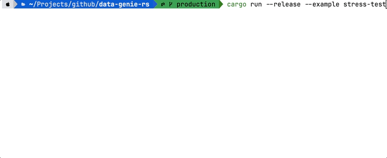

# Data Genie

**`data-genie`** is a high-performance, streaming-first **ETL (Extract, Transform, Load) Engine** written in **Rust**. Designed to process massive datasets (GBs to TBs) with a **constant `O(1)` memory footprint**, it combines Tokio's asynchronous streaming runtime with strong Rust type safety, integrated Dead Letter Queues (DLQ), and multi-transport support.


---

## Core Philosophy

- **O(1) Memory Complexity**: Data is streamed record-by-record via `futures::Stream` (`RecordStream`).
- **Transport Agnostic**: Works seamlessly across Local Files (`FileSource`/`FileSink`), AWS S3 (`S3Source`/`S3Sink`), HTTP APIs (`HttpSource`/`HttpSink`), and Memory (`MemorySource`/`MemorySink`).
- **Fault Tolerance**: Integrated Dead Letter Queues (DLQ) with automatic upstream propagation, exponential backoff (`RetryingWriter`), and Circuit Breakers.
- **Programmatic & Declarative Support**: Run code programmatically in **Rust** or declaratively via **YAML** (see examples below).
---

## Quick Start

This crate uses **Rust edition 2024**. See the [standalone examples](examples/README.md)
for small, complete programs with embedded data and individual run commands.

```shell
cargo run --example csv_to_json
cargo run --example filter_transform
cargo run --example validation_dlq
```

### 1. Synchronous Execution
Call `Job::run_blocking(reader, writer)` directly without `#[tokio::main]`

```rust
use data_genie::{CSVReader, Job, JsonWriter};

fn main() -> data_genie::Result<()> {
    let reader = CSVReader::new("examples/input/users.csv");
    let writer = JsonWriter::new("examples/output/users.json");

    let metrics = Job::run_blocking(reader, writer)?;
    println!("Processed {} records", metrics.record_count);
    Ok(())
}
```

### 2. Asynchronous Execution
If your application already runs inside an async runtime (such as `#[tokio::main]`, Axum, or Actix), use `Job::run(reader, writer).await`:

```rust
use data_genie::{CSVReader, Job, JsonWriter};

#[tokio::main]
async fn main() -> data_genie::Result<()> {
    let reader = CSVReader::new("examples/input/users.csv");
    let writer = JsonWriter::new("examples/output/users.json");

    let metrics = Job::run(reader, writer).await?;
    println!("Processed {} records", metrics.record_count);
    Ok(())
}
```

### 3. Transformations, Filtering & DLQ

```rust
use data_genie::{
    CSVReader, FilterExpression, FilteringReader, Job, JsonWriter,
    RenameField, SelectFields, TransformingReader, ValidatingReader,
};

fn main() -> data_genie::Result<()> {
    let reader = CSVReader::new("examples/input/users.csv");

    let filtered = FilteringReader::new(reader)
        .add_rule(FilterExpression::new("age > 30").create_record_filter());

    let transformed = TransformingReader::new(filtered)
        .add_transform(RenameField::new("fname", "firstName").transform())
        .add_transform(SelectFields::new(["firstName", "email", "age"]).transform());

    // Dead Letter Queue automatically propagates upstream to CSVReader
    let validated = ValidatingReader::new(transformed)
        .with_dlq(JsonWriter::new("examples/output/errors.json"));

    Job::run_blocking(validated, JsonWriter::new("examples/output/users.json"))?;
    Ok(())
}
```

---

## Supported Formats & Connectors

| Category | Readers | Writers |
| :--- | :--- | :--- |
| **Text / Tabular** | `CSVReader`, `TSVReader`, `FixedWidthReader` | `CSVWriter`, `TSVWriter`, `FixedWidthWriter` |
| **Structured / Document** | `JsonReader`, `NDJsonReader`, `XMLReader` | `JsonWriter`, `NDJsonWriter`, `XMLWriter` |
| **Columnar & Spreadsheets** | `ParquetReader`, `XlsxReader` | `ParquetWriter`, `XlsxWriter` |
| **Databases & APIs** | `SQLReader`, `HttpReader` | `SQLWriter` (Postgres, MySQL, SQLite, Oracle Upserts) |
| **Composite & Utility** | `MemoryReader` | `MemoryWriter`, `ConsoleWriter`, `MultiWriter`, `RetryingWriter`, `CallbackWriter`, `BatchCallbackWriter`, `ParallelWriter` |


### 4. Optional Cargo Features

By default, `data-genie` compiles with a minimal dependency footprint. Enable heavy format or cloud connectors only when needed:

```toml
[dependencies]
data-genie = { version = "0.1.4", features = ["parquet", "xlsx", "s3", "http"] } # selected dependency

# OR enable everything:
# data-genie = { version = "0.1.4", features = ["full"] }
```

### 5. CLI Usage

```shell
# Install once
cargo install data-genie

# Run a declarative YAML pipeline
data-genie run pipeline.yaml

# Preview first 5 records of a file
data-genie preview users.csv

# Infer Rust, TypeScript, Zod, and SQL schemas from a dataset
data-genie infer-schema users.csv
```
[Pipeline Builder YAML](https://pujansrt.github.io/data-genie-rs/guide/declarative-pipelines.html#interactive-pipeline-builder)
