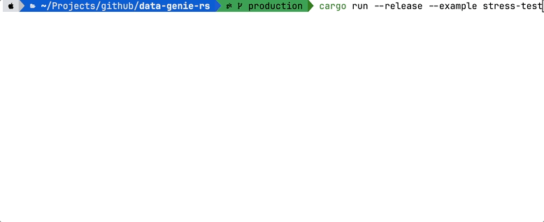

# Data Genie

**`data-genie`** is a high-performance, streaming-first **ETL (Extract, Transform, Load) Engine** written in **Rust**. Streaming pipelines process records
incrementally, so memory usage does not grow with the total number of input records. It combines Tokio's asynchronous streaming runtime with strong Rust type
safety, integrated Dead Letter Queues (DLQ), and multi-transport support.


---

## Core Philosophy

- **Streaming Memory Use**: `RecordStream` processes records one at a time. Streaming memory depends on buffers, the current record, and pipeline state rather
  than total input size.
- **Standard Streams**: Use `StdinSource` and `StdoutSink`, or a quoted `"-"` YAML path, to connect pipelines to shell commands.
- **Transport Agnostic**: Works seamlessly across Local Files (`FileSource`/`FileSink`), AWS S3 (`S3Source`/`S3Sink`), HTTP APIs (`HttpSource`/`HttpSink`), and
  Memory (`MemorySource`/`MemorySink`).
- **Fault Tolerance**: Integrated Dead Letter Queues (DLQ) with automatic upstream propagation, exponential backoff (`RetryingWriter`), and Circuit Breakers.
- **Programmatic & Declarative Support**: Run code programmatically in **Rust** or declaratively via **YAML** (see examples below).

---

## Memory Use

Here is a measured baseline for the built-in streaming path. A release build read a CSV file with one string field per data row (rows were approximately 10 KB;
the final row was shortened to reach the exact file size) and wrote NDJSON to `/dev/null`. Peak resident set size (RSS) was measured with macOS
`/usr/bin/time -l` on an arm64 machine using Rust 1.95.0.

| Input size                    | Records processed | Peak RSS |
|:------------------------------|------------------:|---------:|
| 100 KiB (102,400 bytes)       |                11 |  7.1 MiB |
| 100 MiB (104,857,600 bytes)   |            10,486 |  7.9 MiB |
| 10 GiB (10,737,418,240 bytes) |         1,073,742 |  7.9 MiB |

Reproduce with `cargo build --release --bin data-genie`, then run `data-genie run pipeline.yaml` under `/usr/bin/time -l`. The pipeline should read the
generated CSV and write to `/dev/null`; keep the row size approximately 10 KB to make results comparable. These figures are a baseline for that setup, not a
guarantee for every pipeline.

Memory remains independent of the number of records for the streaming path, but it is not a fixed amount for every workload. A single very large record,
full-file formats or operations, grouping and deduplication state, parallel batches, and in-memory sources or sinks can increase memory use. For example,
`GroupByReader` retains aggregate state until input is exhausted, and `MemoryWriter` retains all output records.

---

## Quick Start

This crate uses **Rust edition 2024**. See the [standalone examples](examples/README.md)
for small, complete programs with embedded data and individual run commands.

```shell
cargo run --example csv_to_json
cargo run --example filter_transform
cargo run --example validation_dlq
```

### 1. Synchronous Execution

Call `Job::run_blocking(reader, writer)` directly without `#[tokio::main]`

```rust
use data_genie::{CSVReader, Job, JsonWriter};

fn main() -> data_genie::Result<()> {
    let reader = CSVReader::new("examples/input/users.csv");
    let writer = JsonWriter::new("examples/output/users.json");

    let metrics = Job::run_blocking(reader, writer)?;
    println!("Processed {} records", metrics.record_count);
    Ok(())
}
```

### 2. Asynchronous Execution

If your application already runs inside an async runtime (such as `#[tokio::main]`, Axum, or Actix), use `Job::run(reader, writer).await`:

```rust
use data_genie::{CSVReader, Job, JsonWriter};

#[tokio::main]
async fn main() -> data_genie::Result<()> {
    let reader = CSVReader::new("examples/input/users.csv");
    let writer = JsonWriter::new("examples/output/users.json");

    let metrics = Job::run(reader, writer).await?;
    println!("Processed {} records", metrics.record_count);
    Ok(())
}
```

### 3. Transformations, Filtering & DLQ

```rust
use data_genie::{
    CSVReader, FilterExpression, FilteringReader, Job, JsonWriter,
    RenameField, SelectFields, TransformingReader, ValidatingReader,
};

fn main() -> data_genie::Result<()> {
    let reader = CSVReader::new("examples/input/users.csv");

    let filtered = FilteringReader::new(reader)
        .add_rule(FilterExpression::new("age > 30").create_record_filter());

    let transformed = TransformingReader::new(filtered)
        .add_transform(RenameField::new("fname", "firstName").transform())
        .add_transform(SelectFields::new(["firstName", "email", "age"]).transform());

    // Dead Letter Queue automatically propagates upstream to CSVReader
    let validated = ValidatingReader::new(transformed)
        .with_dlq(JsonWriter::new("examples/output/errors.json"));

    Job::run_blocking(validated, JsonWriter::new("examples/output/users.json"))?;
    Ok(())
}
```

---

## Supported Formats & Connectors

| Category                    | Readers                                      | Writers                                                                                                                     |
|:----------------------------|:---------------------------------------------|:----------------------------------------------------------------------------------------------------------------------------|
| **Text / Tabular**          | `CSVReader`, `TSVReader`, `FixedWidthReader` | `CSVWriter`, `TSVWriter`, `FixedWidthWriter`                                                                                |
| **Structured / Document**   | `JsonReader`, `NDJsonReader`, `XMLReader`    | `JsonWriter`, `NDJsonWriter`, `XMLWriter`                                                                                   |
| **Columnar & Spreadsheets** | `ParquetReader`, `XlsxReader`                | `ParquetWriter`, `XlsxWriter`                                                                                               |
| **Databases & APIs**        | `SQLReader`, `HttpReader`                    | `SQLWriter` (Postgres, MySQL, SQLite, Oracle Upserts)                                                                       |
| **Composite & Utility**     | `MemoryReader`                               | `MemoryWriter`, `ConsoleWriter`, `MultiWriter`, `RetryingWriter`, `CallbackWriter`, `BatchCallbackWriter`, `ParallelWriter` |

### 4. Optional Cargo Features

By default, `data-genie` compiles with a minimal dependency footprint. Enable heavy format or cloud connectors only when needed:

```toml
[dependencies]
data-genie = { version = "0.1.7", features = ["parquet", "xlsx", "s3", "http"] } # selected dependency

# OR enable everything:
# data-genie = { version = "0.1.7", features = ["full"] }
```

### 5. CLI Usage

```shell
# Install once and add cargo to PATH
cargo install data-genie

# Run a declarative YAML pipeline
data-genie run pipeline.yaml

# Preview first 5 records of a file
data-genie preview users.csv

# Infer Rust, TypeScript, Zod, and SQL schemas from a dataset
data-genie infer-schema users.csv
```

[Pipeline Builder YAML](https://pujansrt.github.io/data-genie-rs/guide/declarative-pipelines.html#interactive-pipeline-builder)
