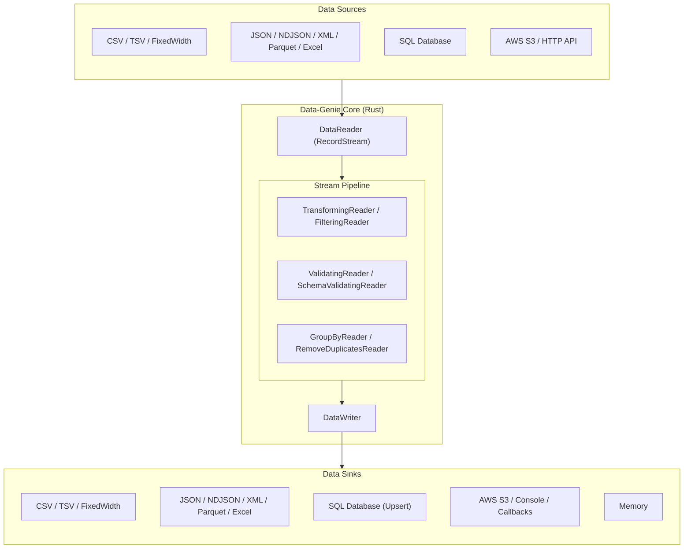

# Architecture Overview

Data-Genie is built on three core traits: **`DataReader`**, **Transformers/Filters** (composable `DataReader` decorators), and **`DataWriter`**, connected by asynchronous Rust streams (`RecordStream`).

## The Pipeline Flow

## Core Components

### 1. `DataReader` & `DataSource`
Fetches raw bytes from a `DataSource` and parses them into a stream of `Record` (`IndexMap<String, Value>`).
- **`FileSource`**: Streams from local disk using `tokio::fs::File`.
- **`S3Source`**: Streams directly from AWS S3 buckets.
- **`HttpSource`**: Streams from HTTP/REST endpoints.
- **`MemorySource`**: Reads from in-memory bytes or strings.

### 2. Transformers & Filters
Act as composable middleware wrapping any `DataReader`:
- **`TransformingReader`**: Rename fields, compute expressions, convert types, mask PII, or select/remove fields.
- **`FilteringReader`**: Keep only records matching field rules or boolean expressions (`FilterExpression`).
- **`SchemaValidatingReader` & `ValidatingReader`**: Validate records against a `SchemaDefinition` or custom rules.

### 3. Resilience & Dead Letter Queues (DLQ)
Data-Genie is built for messy real-world datasets. When you attach `.with_dlq(writer)` on a `ValidatingReader` or `SchemaValidatingReader`, it automatically propagates the DLQ writer upstream to the source reader (`CSVReader`, `JsonReader`, etc.). Malformed rows or validation failures are diverted to the DLQ without halting the pipeline.

### 4. `DataWriter` & `DataSink`
Persists processed records to a destination:
- **File/Cloud Writers**: `CSVWriter`, `JsonWriter`, `NDJsonWriter`, `XMLWriter`, `ParquetWriter`, `XlsxWriter`.
- **`SQLWriter`**: Dialect-aware bulk inserts and idempotent upserts (`Postgres`, `MySQL`, `SQLite`, `Oracle`).
- **Composite Writers**: `MultiWriter` (fan-out), `ParallelWriter` (multi-core worker pool), `RetryingWriter` (backoff + circuit breaker), `CallbackWriter`, and `BatchCallbackWriter`.

### 5. `Job` Orchestrator
`Job` drives the async stream from reader to writer, tracks throughput (`JobMetrics`), and emits lifecycle callbacks (`on_start`, `on_progress`, `on_record`, `on_error`, `on_complete`).
